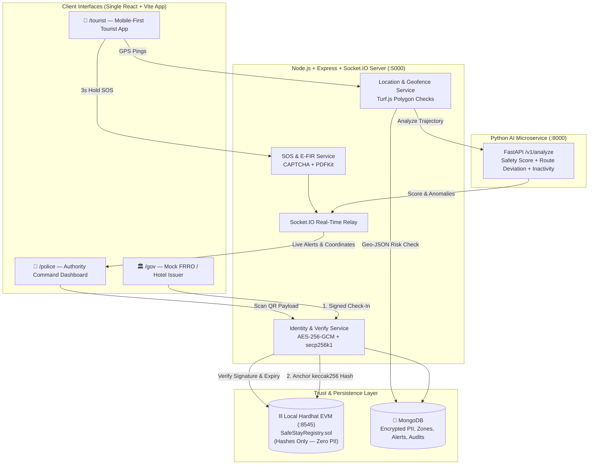
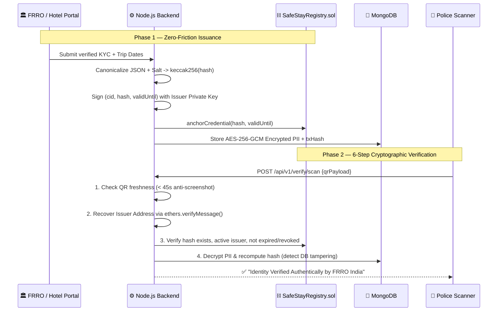

<div align="center">

# 🛡️ SafeStay India
### Smart Tourist Safety Monitoring & Incident Response System

[](#system-architecture)
[](#blockchain-root-of-trust)
[](#tech-stack)
[](#tech-stack)
[](#ai-anomaly--safety-score-engine)
[](#license)

**Proactive tourist safety powered by AI Anomaly Detection, Dynamic Geo-Fencing, and Privacy-First Blockchain Digital IDs — built as a zero-cost, local-first MVP.**

[Problem & Solution](#-problem-statement--solution) • [Architecture](#-system-architecture) • [Core Modules](#-core-modules--features) • [Tech Stack](#-tech-stack) • [Local Setup](#-quick-start-local-setup) • [5-Min Demo](#-5-minute-live-demo-walkthrough) • [API Docs](#-api-reference)

</div>

---

## 📖 Table of Contents
1. [Problem Statement & Solution](#-problem-statement--solution)
2. [System Architecture](#-system-architecture)
3. [Blockchain Root-of-Trust Model](#-blockchain-root-of-trust)
4. [Core Modules & Features](#-core-modules--features)
5. [Tech Stack](#-tech-stack)
6. [Project Directory Structure](#-project-directory-structure)
7. [Quick Start (Local Setup)](#-quick-start-local-setup)
8. [5-Minute Live Demo Walkthrough](#-5-minute-live-demo-walkthrough)
9. [API Reference](#-api-reference)
10. [Security, Cryptography & Privacy](#-security-cryptography--privacy)
11. [Production Upgrade Roadmap](#-production-upgrade-roadmap)
12. [Contributing & License](#-license)

---

## 🎯 Problem Statement & Solution

### The Challenge
Tourists visiting remote, mountainous, or low-connectivity regions (such as Northeast India) face four critical safety gaps:
- **Ineffective Manual Tracking:** Physical patrolling and manual check-ins do not scale across vast, rugged terrains.
- **Zero Proactive Monitoring:** Authorities only learn about a distressed or missing tourist hours after an incident occurs.
- **Delayed Emergency Response:** Verifying identity, locating emergency contacts, and pinpointing last known coordinates wastes critical response time.
- **Document & Accessibility Risks:** Carrying physical passports/IDs everywhere risks loss or damage, while language barriers make safety information difficult to access.

### The SafeStay India Solution
**SafeStay India** is a unified, **100% software-driven safety ecosystem** (no external IoT hardware required) connecting three stakeholders in real time:
1. **Authorized Entry Portals (`/gov`)** — Airport Immigration (FRRO) and registered hotels issue cryptographically signed, trip-bound Digital IDs via a zero-friction API plug-in.
2. **Tourist Mobile-First App (`/tourist`)** — Displays the rotating Blockchain QR Digital ID, calculates an AI Safety Score, warns users before entering high-risk geo-fenced zones, and provides a 3-second hold SOS panic button.
3. **Police & Tourism Command Dashboard (`/police`)** — Visualizes live tourist clusters, active SOS/anomaly alerts, verifies Digital IDs cryptographically via a built-in browser QR scanner, and generates 1-click **Automated E-FIR PDFs**.

---

## 🏗️ System Architecture



---

## ⛓️ Blockchain Root-of-Trust

A common flaw in digital ID prototypes is allowing users to self-upload documents (which lets attackers upload forged IDs onto a blockchain). SafeStay India solves this using **Issuer-Signed Public Key Infrastructure (PKI)** and **Off-Chain Encrypted Storage**:



### Failure Detection Codes
If any check fails during police verification, the scanner immediately rejects the ID with an explicit security status:
- `REPLAY` — QR timestamp is older than 45 seconds (prevents screenshot sharing).
- `FORGED_SIGNATURE` — Signature does not match any authorized government/hotel issuer key.
- `NOT_ON_CHAIN` — Hash was never anchored on `SafeStayRegistry.sol`.
- `EXPIRED` / `REVOKED` — Trip validity window has ended or issuer revoked the credential.
- `DB_TAMPERED` — Database record was altered after blockchain anchoring (hash mismatch).

---

## 🧩 Core Modules & Features

### 1. Mock FRRO / Hotel Check-In Portal (`/gov`)
- Simulates backend API integration with existing government/hotel systems (IVFRT / Form-C) so officers require zero extra apps.
- Captures basic tourist details, trip duration, and emergency contacts, then mints a temporary blockchain-backed credential valid strictly for the trip duration.

### 2. Mobile-First Tourist App (`/tourist`)
- **Trust-First UI:** High-contrast accessible interface using Primary Blue (`#2563EB`), Dark Blue (`#1E40AF`), and Emergency Red (`#DC2626`).
- **Blockchain Digital ID Card:** Displays tourist profile, live validity countdown, and a **30-second rotating QR code** (plus a *"Test Tampered QR"* toggle for live fraud-detection demos).
- **Live Map & Geo-Fencing:** Built with Leaflet + OpenStreetMap + `@turf/turf`. Entering a high-risk GeoJSON polygon triggers an instant warning modal with a **"Get Safe Directions"** action.
- **Classroom GPS Simulator:** Includes a **"Simulate Walk into Danger Zone"** button to demonstrate live movement, geo-fence alerts, and real-time Safety Score drops indoors.
- **Smart SOS Panic Protocol:** Floating red SOS button requires a **3-second hold** to prevent accidental triggers. Cancelling an active SOS requires solving a **server-verified CAPTCHA**.
- **AI Trip-Planning Chatbot & Multilingual Support:** Provides safe travel tips, route planning, and accessible UI support for diverse travelers.

### 3. AI Anomaly & Safety Score Engine (`ai-engine/`)
- Decoupled **Python FastAPI** service (`POST /v1/analyze`) computing:
  - **Real-Time Safety Score (`0–100`)** with transparent factor breakdown for the UI tooltip (`?`).
  - **Route Deviation Detection:** Flags movement exceeding the planned itinerary corridor (`> 500m`).
  - **Prolonged Inactivity Detection:** Flags unexpected stationary periods outside safe/hotel zones, weighted higher during nighttime hours.
  - **2-Step Escalation:** Prompts a soft in-app check-in first before escalating high-severity alerts to the Police Dashboard to minimize false alarms.

### 4. Police & Tourism Command Dashboard (`/police`)
- **Real-Time Command Map:** Displays seeded high-risk danger polygons, tourist activity, and blinking red SOS/anomaly markers pushed over Socket.IO.
- **Built-In Browser QR Scanner:** Uses `html5-qrcode` (plus a paste/upload fallback for laptop demos without a webcam) to cryptographically verify tourist IDs on the spot.
- **Incident Dossier & 1-Click E-FIR:** Clicking any active alert reveals verified identity details, emergency contacts, and last known coordinates, with a 1-click **"Download E-FIR PDF"** button powered by `pdfkit`.

---

## 🛠️ Tech Stack

This MVP is intentionally engineered to be **100% free and local-first** (zero credit cards, zero cloud billing, zero API key lockouts):

| Layer | Local MVP Stack (Implemented) | Production Upgrade Path |
| :--- | :--- | :--- |
| **Frontend** | React (Vite), Tailwind CSS, React Router | React PWA wrapped with Capacitor / Flutter |
| **Maps & Geofencing** | Leaflet, OpenStreetMap, `@turf/turf` | Google Maps / Mapbox + Radar SDK |
| **Backend & Real-Time** | Node.js, Express, Socket.IO, `pdfkit` | Node.js Cluster + Firebase RTDB/FCM + Redis Streams |
| **AI Microservice** | Python, FastAPI, Uvicorn, Shapely | FastAPI + TensorFlow / Isolation Forest Autoencoder |
| **Blockchain** | Solidity (`^0.8.24`), Local Hardhat Node, `ethers.js` | Polygon / Hyperledger Besu (NIC-hosted nodes) |
| **Database & Security** | MongoDB (`2dsphere` + TTL), AES-256-GCM, `secp256k1` | MongoDB Time-Series + HashiCorp Vault KMS |
| **QR Tools** | `qrcode.react`, `html5-qrcode` | Hardware-bound device keys + CCTNS SDK |

---

## 📂 Project Directory Structure

```text
safestay-mvp/
├── contracts/                      # Local Hardhat EVM & Solidity Smart Contract
│   ├── contracts/
│   │   └── SafeStayRegistry.sol    # Immutable hash registry & issuer access control
│   ├── scripts/
│   │   └── deploy.js               # Deploys locally, registers FRRO issuer, exports ABI
│   └── test/
│       └── SafeStayRegistry.test.js
├── backend/                        # Node.js + Express + Socket.IO API Server
│   ├── config/
│   │   └── contract.json           # Auto-generated contract address & ABI
│   ├── models/                     # Mongoose schemas (Tourist, Credential, Zone, Alert)
│   ├── routes/                     # /api/v1 REST endpoints
│   ├── services/
│   │   ├── identity.service.js     # Encryption, canonical hashing, issuer signing
│   │   ├── verify.service.js       # 6-step cryptographic & anti-tamper verification
│   │   ├── geofence.service.js     # Turf.js polygon checks + AI engine bridge
│   │   └── efir.service.js         # Automated PDFKit E-FIR generator
│   ├── seed.js                     # Seeds sample high-risk GeoJSON danger polygons
│   └── server.js
├── ai-engine/                      # Python FastAPI Anomaly Detection Service
│   ├── main.py                     # FastAPI app exposing POST /v1/analyze
│   ├── detector.py                 # Safety Score, Route Deviation & Inactivity engine
│   ├── test_ai.py                  # Normal vs. anomalous trajectory test script
│   └── requirements.txt
├── frontend/                       # Unified React (Vite) + Tailwind CSS Application
│   └── src/
│       ├── pages/
│       │   ├── GovPortal.jsx       # /gov — Mock FRRO/Hotel issuer portal
│       │   ├── TouristApp.jsx      # /tourist — Mobile-first app + GPS simulator
│       │   └── PoliceDashboard.jsx # /police — Live map, QR scanner & E-FIR panel
│       └── components/             # SOSHoldButton, SafetyScoreCard, GeofenceModal, etc.
├── VIVA_NOTES.md                   # Module-by-module dry runs & Q&A documentation
└── README.md
```

---

## 🚀 Quick Start (Local Setup)

### Prerequisites
- **Node.js** `v18+` & **npm**
- **Python** `3.10+` & **pip**
- **MongoDB** running locally (`mongodb://127.0.0.1:27017`) or a free MongoDB Atlas URI

### 1. Clone the Repository
```bash
git clone [https://github.com/](https://github.com/)<your-username>/safestay-india.git
cd safestay-india
```

### 2. Configure Environment Variables
Create `backend/.env` using the template below:
```env
PORT=5000
MONGO_URI=mongodb://127.0.0.1:27017/safestay
HARDHAT_RPC_URL=[http://127.0.0.1:8545](http://127.0.0.1:8545)
# Paste Account #1 private key printed by `npx hardhat node`
ISSUER_PRIVATE_KEY=0x59c6995e998f97a5a0044966f0945389dc9e86dae88c7a8412f4603b6b78690d
# Any 64-character hex string (32 bytes) for AES-256-GCM PII encryption
PII_ENCRYPTION_KEY=0123456789abcdef0123456789abcdef0123456789abcdef0123456789abcdef
AI_ENGINE_URL=[http://127.0.0.1:8000](http://127.0.0.1:8000)
JWT_SECRET=safestay_local_dev_secret
```

### 3. Launch All 4 Services (Open 4 Separate Terminals)

#### Terminal 1 — Local Hardhat Blockchain Node
```bash
cd contracts
npm install
npx hardhat node
```
*(In a quick one-time command while Terminal 1 stays running, deploy the contract and run tests:)*
```bash
cd contracts
npx hardhat run scripts/deploy.js --network localhost
npx hardhat test
```

#### Terminal 2 — Python AI Microservice
```bash
cd ai-engine
pip install -r requirements.txt
uvicorn main:app --reload --port 8000
```

#### Terminal 3 — Node.js Backend & Seed Danger Zones
```bash
cd backend
npm install
node seed.js
npm run dev
```

#### Terminal 4 — React Frontend
```bash
cd frontend
npm install
npm run dev
```

Once all four terminals are running, open **`http://localhost:5173`** in your browser.

---

## 🎬 5-Minute Live Demo Walkthrough

Open the three views side-by-side in separate browser tabs/windows to experience the full end-to-end workflow:

| Step | Route | Action to Perform | Expected Result |
| :---: | :--- | :--- | :--- |
| **1** | `/gov` | Fill in a sample tourist check-in (Name, Passport No., Nationality, Trip Days, Emergency Contact) and click **Issue Digital ID**. | PII is encrypted in MongoDB, signed by FRRO's private key, and its `keccak256` hash is anchored on the local Hardhat blockchain. |
| **2** | `/tourist` | Open the **Digital ID** tab to view the card, validity timer, and 30-second rotating QR code. | Live cryptographic QR envelope renders on screen. |
| **3** | `/police` | Scan (or paste) the tourist's QR code in the **Police QR Scanner**. Then toggle **"Test Tampered QR"** on `/tourist` and scan again. | Authentic QR returns green **`Verified by FRRO India`**. Tampered QR immediately fails with red **`FORGED_SIGNATURE` / `DB_TAMPERED`**. |
| **4** | `/tourist` | Switch to **Home** and click **"Simulate Walk into Danger Zone"**. | Marker enters the red GeoJSON polygon → triggers Geo-Fence Warning Modal (*"Get Safe Directions"*) and Python AI dynamically drops the Safety Score. |
| **5** | `/tourist` → `/police` | Hold the red **SOS Button** for 3 seconds (test CAPTCHA on Cancel). Check `/police` and click **"Download E-FIR PDF"**. | Blinking red SOS marker appears live on the Police Dashboard via Socket.IO; pre-filled E-FIR PDF downloads immediately. |

---

## 🔌 API Reference

### Node.js Backend (`http://localhost:5000/api/v1`)
| Method | Endpoint | Description |
| :--- | :--- | :--- |
| `POST` | `/gov/checkin` | Encrypts PII, signs canonical payload, anchors `keccak256` hash on Hardhat chain |
| `POST` | `/verify/scan` | Executes 6-step replay, signature, on-chain, and DB-hash verification |
| `POST` | `/location/ping` | Evaluates Turf.js geofence polygons, calls Python AI service, broadcasts alerts |
| `GET` | `/zones` | Fetches seeded high-risk GeoJSON polygons for map rendering |
| `POST` | `/sos/trigger` | Creates high-priority SOS incident and streams live coordinates via Socket.IO |
| `GET` | `/sos/captcha` | Issues time-bound server-signed CAPTCHA challenge for SOS cancellation |
| `POST` | `/sos/:id/cancel` | Validates CAPTCHA before cancelling an active SOS alert |
| `GET` | `/incidents/:id/efir` | Generates and streams a downloadable pre-filled E-FIR PDF document |

### Python AI Engine (`http://localhost:8000`)
| Method | Endpoint | Description |
| :--- | :--- | :--- |
| `POST` | `/v1/analyze` | Accepts GPS ping history + planned route; returns `safetyScore` (`0–100`), `anomalies`, and `recommendedAction` |

---

## 🔒 Security, Cryptography & Privacy

- **Zero PII On-Chain (DPDP Act Aligned):** Personal details never touch the blockchain. Only the salted `keccak256` hash, issuer address, and expiry timestamp are anchored on-chain. Expiring or deleting the encrypted off-chain database record renders the on-chain hash anonymous and untraceable.
- **Anti-Forgery Root-of-Trust:** Even database or backend administrators cannot forge an *"Approved by FRRO"* credential without possessing the issuer's `secp256k1` private key.
- **Anti-Screenshot Replay Protection:** QR codes carry a fresh timestamp (`< 45s` window) and rotating signature to block screenshot reuse.
- **Opt-In Privacy Controls:** Live location visibility for law enforcement is disabled by default and unlocks only when the tourist explicitly opts in or triggers an SOS / escalated anomaly.
- **Immutable Access Audits:** Every police QR scan logs the officer ID, timestamp, and location to prevent unauthorized surveillance.

---

## 🗺️ Production Upgrade Roadmap

- [ ] **Native Background GPS:** Wrap the React PWA with **Capacitor** or migrate to **Flutter** for persistent background location tracking when mobile screens are locked.
- [ ] **Consortium Blockchain Deployment:** Move from local Hardhat node to **Polygon / Hyperledger Besu** permissioned nodes hosted on government/NIC infrastructure.
- [ ] **ML Trajectory Models:** Upgrade rule-based anomaly scoring with an unsupervised **Isolation Forest / LSTM Autoencoder** trained on regional tourist movement patterns.
- [ ] **Direct National Integrations:** Connect backend webhooks to official **IVFRT / Form-C** portals and emergency response helplines (`112` / `108`).
- [ ] **Offline Map Tile Caching:** Pre-cache OpenStreetMap vector tiles and risk polygons on-device for zero-network mountain corridors.

---

## 📄 License

Distributed under the **MIT License**. See `LICENSE` for more information.

---

<div align="center">
Built with ❤️ for Safer, Smarter Tourism in India.
</div>
